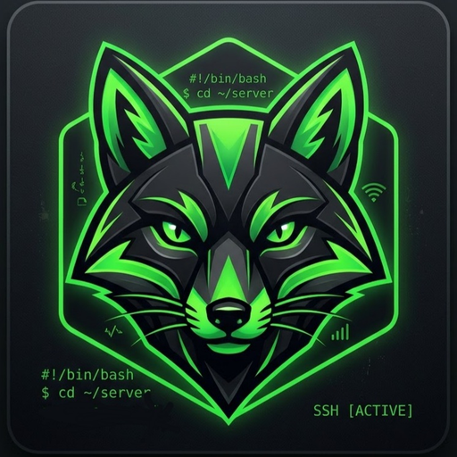

  

<h1 align="center">Vulpes</h1>

  <b>A pocket server room for your Android phone.</b> 
  Run your Python projects straight from GitHub: no PC, no hosting bill.

  
  
  

---

## What is Vulpes?

Vulpes turns your phone into a small, always-in-your-pocket server environment, in the spirit of a terminal app but built around **your GitHub repositories**.

Sign in with GitHub, pick a repository, set a start command, and Vulpes runs your code on your device. It is built for Telegram bots, userbots, small APIs and scripts that you would normally deploy to a hosting service.

## Highlights

| | |
|---|---|
| **GitHub sign-in** | Secure device-flow login. Vulpes never sees your password. |
| **Your repos, your servers** | Pick a repository, add a start command, press start. |
| **Built-in console** | Every server runs in its own CMD-style screen. |
| **Logs and Errors, separated** | System and user activity go to Logs. Problems go to Errors, with a badge when you are on another screen. |
| **Smart network handling** | If your connection drops, servers are paused and logged. When it returns, they resume. |
| **Library manager** | See which packages were installed for each server. Common ones come prebuilt. |
| **Day and night themes** | Clean black and white themes with a soft particle background. |

## Status

Vulpes is under active development. The first public builds are **v0.x** preview releases.

- [x] Animated launch screen
- [x] GitHub sign-in (device flow)
- [x] Day and night themes, particle background
- [x] Four-tab layout: Computers, Logs, Errors, Library
- [ ] Repository picker and server setup
- [ ] Python runtime and package manager
- [ ] Live logs, error tracking and badges
- [ ] Pause and resume on connection loss
- [ ] In-app announcements from the developer
- [ ] Free trial and access codes

## Install

1. Open the [**Releases**](https://github.com/NightFox-Studio/vulpes-releases/releases/latest) page and download the latest `Vulpes-vX.X.apk`.
2. When Android asks, allow installing apps from this source.
3. Open Vulpes and sign in with GitHub.

**Requirements:** Android 8.0 or newer, 64-bit ARM device.

> Tip: for servers to keep running in the background, disable battery optimization for Vulpes in your phone settings.

## Privacy and security

- Sign-in uses GitHub's official device flow. Your password is never entered in the app.
- Your access token is stored encrypted on your device using the Android Keystore.
- Your code runs locally on your phone.

## Support and contact

Questions, bugs or ideas? Message me on Telegram: **[@VULPESuskun](https://t.me/VULPESuskun)**

## Legal

Vulpes is an independent project. It is not affiliated with, endorsed by, or sponsored by GitHub, Telegram or Termux. All trademarks belong to their respective owners.

Copyright © 2026 NightFox Studio. All rights reserved. This repository hosts releases only; the source code is private.
